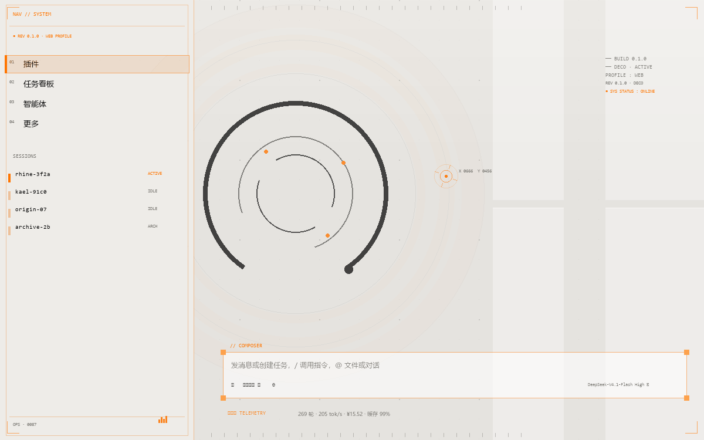
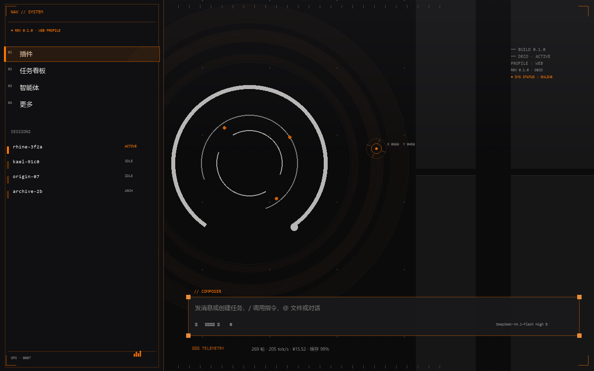
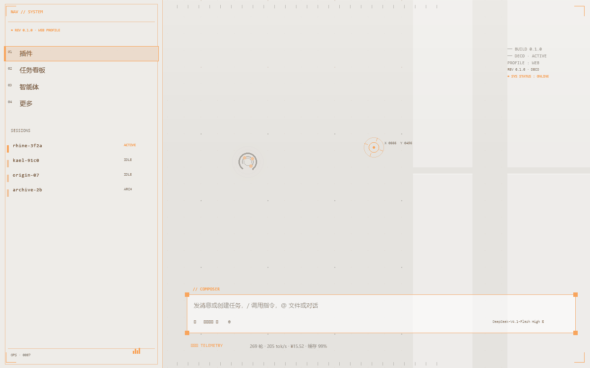

# dsh-tech-deco

给 DeepSeek Harness 加一层简约科技风装饰：准星圆环、工程点阵、长条方块、指针 HUD、侧栏框与选中提示音。
装好后进入主界面即可看到效果，不需要额外配置。

---

## 效果预览

| 浅色主题 | 深色主题 |
|---|---|
|  |  |

进入界面时，准星从小圈放大到目标尺寸，同时由淡转清：



---

## 功能

**背景**
边缘渐晕、34px 工程点阵（每 4 格一个亮点）、两侧长条方块缓慢下滑、准星圆环（粗弧 18 秒一圈、细环 10.8 秒反向）、外围暖色柔光与三道同心呼吸环、每 26 秒一次的扫描线。

**指针 HUD**
鼠标移动时出现：10px 橙环 + 20px 拖尾环 + 四向刻度 + 中心点 + `X 0123  Y 0456` 坐标读数。

**界面装饰**

| 位置 | 内容 |
|---|---|
| 四角 | 20px 橙色 L 形标 |
| 顶部 / 底部 | 各 25 根刻度 |
| 左缘 | 13 根竖向刻度（每 4 根一根加长） |
| 右上 | `BUILD 0.1.0` / `DECO · ACTIVE` / `PROFILE : WEB` / `REV` / `SYS STATUS : ONLINE` |
| 侧栏 | 整块橙色描边框、`NAV // SYSTEM`、`REV 0.1.0 · WEB PROFILE`、导航序号 `01`–`04`、会话行左侧方块标记、底部 `OPS · 0087` + 电平条 |
| 输入区 | `// COMPOSER` 描边框 + 四角方块 |
| 状态条 | `▮▮▮ TELEMETRY` |

**选中框与音效**
鼠标划过可点栏位时出现橙色选中框（四角方块 + 左竖条 + 淡橙填充），点击后短暂转亮金；侧栏项悬停有清脆一声「叮」，点击有「哒—咚」。

**进入动画**
打开页面后，准星从 0.12 倍半径放大到正常大小，透明度从 35% 渐入到 100%，历时约 3.2 秒。

---

## 设置

**DSH 设置 →「科技装饰」**，顶部分类可点击直接跳到对应分区。

| 分类 | 选项 | 说明 |
|---|---|---|
| 动效 | 圆环转速 | 0.25–3×，1× 约 18 秒转一圈 |
| | 背景方块速度 | 0.25–3× |
| | 指针跟随 | 立即跟随 / 贴近跟随 / 延迟跟随（延迟会有明显拖尾） |
| 视觉 | 整体浓度 | 0–2，0 几乎不可见，2 为默认 |
| | 主题配色 | 跟随 startup·系统 / 强制浅色 / 强制深色 |
| 声音 | 选中提示音量 | 0–100% |
| 重置 | 恢复默认 | 一键回到出厂设置 |

所有调整即时生效，保存后刷新仍然保留。

---

## 安装

```bash
dsh plugin --profile web add ./dsh-tech-deco-0.1.0.tgz
```

装完重启 dsh web。桌面端把 `web` 换成 `desktop`，或在应用内「插件」页安装。

卸载：

```bash
dsh plugin --profile web remove dsh-tech-deco
```

---

## 环境要求

| 项 | 要求 |
|---|---|
| Node | >= 20 |
| DSH | 0.2.1 及以上 |
| 依赖 | 无 |

---

## 许可

本作品采用 **CC BY-NC-ND 4.0**（署名—非商业—禁止演绎）授权。
个人非商业使用与原样转载（须署名并附协议链接）许可；商业使用、修改后分发、隐藏作者署名均不允许。

完整条款见 [LICENSE](LICENSE)。

---

Copyright © 2026 沈宏宏
